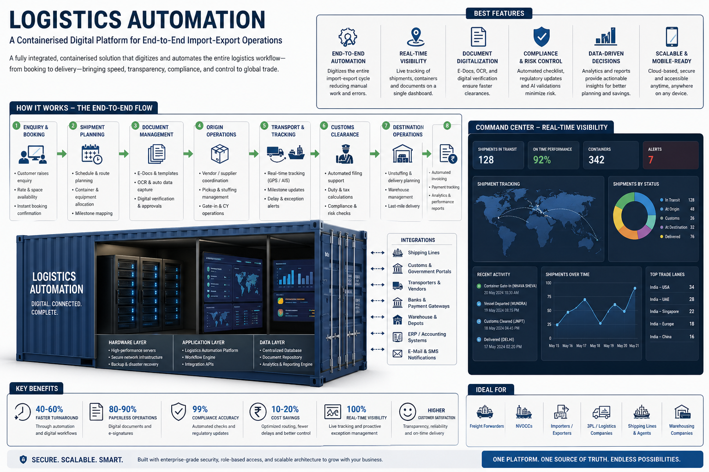

# 🌐 LogisticsAuto

A prototype that automates the digitization, parsing, and risk scoring of international trade documents such as invoices.

[](https://github.com/adar-shh04/Logistics-Automation)


## 🎯 Project Overview
**LogisticsAuto** takes an uploaded document, extracts its text and key fields in a background worker, scores the transaction for risk, and shows the result on a dashboard.

### ✅ What It Does
- **Asynchronous stream processing**: uploads return immediately while a Python worker processes tasks dispatched through a Redis Stream.
- **Structured extraction**: EasyOCR reads text from invoice images and Gemini extracts fields such as invoice number, amount, party, and HS code.
- **Risk scoring**: an Isolation Forest model scores each transaction from 0 to 1 and flags scores above 0.6.
- **HS code lookup**: extracted codes are matched against a sample CSV to attach item descriptions.
- **Audit trail**: each processed document is written to PostgreSQL and appended to a SHA-256 hash-chained ledger file.

> **Status:** this is a portfolio prototype. It has not been benchmarked or used on production shipments, so no accuracy, speed, or cost figures are claimed. The Isolation Forest is trained on synthetic data (`backend/app/train_model.py`), and the HS code table is a sample.

---

## 🏗️ Technical Architecture

```
React dashboard  --HTTP-->  Spring Boot API (Java 21)  --XADD-->  Redis Stream "logistics:jobs"
                                   |                                        |
                                   | JPA (read/write documents)             | XREADGROUP (group "workers")
                                   v                                        v
                               PostgreSQL  <----- writes results ------  Python worker
                                                                         (OCR, Gemini, HS, Isolation Forest, audit)
```

**Docker Compose** runs five services: `db`, `redis`, `api`, `worker`, and `frontend`.

### 🧠 Services & Components
- **API (`api-java/`)**: Java 21 & Spring Boot 3.4 REST service handling document upload, job dispatch to Redis Streams, status checks, transaction queries, and Flyway database migrations (`V1__init.sql`).
- **PostgreSQL 15 (`db`)**: stores documents, transactions, and audit records.
- **Redis 7 (`redis`)**: Redis Stream (`logistics:jobs`) message broker between the API and worker.
- **Worker (`backend/`)**: Python stream worker consuming jobs with `XREADGROUP` and `XAUTOCLAIM`, running OCR, Gemini parsing, HS code lookup, Isolation Forest scoring, and ledger hashing.
- **Dashboard (`frontend/`)**: React 18 & Vite dashboard with Tailwind CSS styling and polling with timeout/failure handling.

---

## 🔄 The End-to-End Flow

1. **Upload**: A PNG or JPG invoice is uploaded via `POST /upload`. The Spring Boot API validates file type and size, generates a unique UID, saves the image to the shared volume, records the document row in PostgreSQL, and enqueues a job with `XADD` onto Redis Stream `logistics:jobs`.
2. **Stream Consumer**: The Python worker consumes the job from `logistics:jobs` using consumer group `workers`.
3. **Idempotency Check**: If a transaction already exists for `document_id`, the worker marks the document completed and ACKs immediately to prevent duplicate transactions or ledger entries.
4. **Processing Pipeline**:
   - **OCR**: EasyOCR extracts text from image bytes.
   - **Gemini**: Parses text into structured fields.
   - **HS Code**: Looks up classification from `hs_codes.csv`.
   - **Risk Scoring**: Isolation Forest scores transaction features.
5. **Atomic Persistence**: The worker records the `transactions` entry, sets `documents.status='completed'`, and appends to the hash-chained audit ledger.
6. **Result Display**: The React frontend polls `GET /status/{uid}` and displays formatted transaction totals and risk indicators.

---

## 🛠️ Running the Application

### Prerequisites
- [Docker Desktop](https://www.docker.com/products/docker-desktop/)
- [Google Gemini API Key](https://aistudio.google.com/app/apikey)

### Quick Start
1. **Environment Setup**:
   ```bash
   cp .env.example .env
   # Add your GEMINI_API_KEY to .env
   ```

2. **Reset Database Volume & Launch**:
   > Note: To initialize with Flyway migrations on a clean database volume, reset existing volumes:
   ```bash
   docker compose down -v
   docker compose up --build -d
   ```

3. **Access Points**:
   - **Dashboard**: `http://localhost:5173`
   - **API Health**: `http://localhost:8000/health`
   - **Swagger UI**: `http://localhost:8000/swagger-ui.html`

---

## 🧪 Running Tests

### Java API Tests
Run all unit and Testcontainers integration tests (requires Docker running for PostgreSQL and Redis containers):
```bash
cd api-java
./mvnw test
```

### Python Worker Tests
Run pytest unit tests (uses fakeredis, stubs OCR and Gemini):
```bash
python -m pytest backend/tests -v
```

### Frontend Build
Verify frontend production build:
```bash
cd frontend
npm ci
npm run build
```

---

*Developed by [adar-shh04](https://github.com/adar-shh04)*
