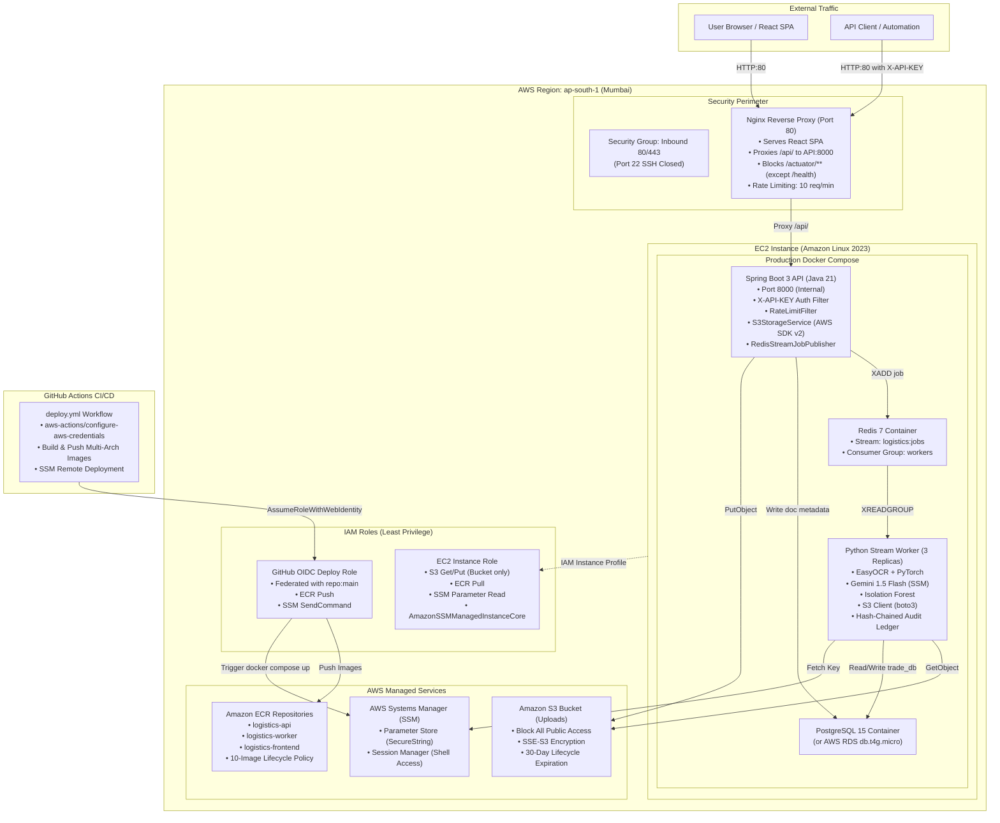

# AWS Production Deployment Guide

This guide documents the architecture, automated provisioning, deployment pipeline, security lockdown, and verification procedures for deploying **LogisticsAuto** to Amazon Web Services (AWS) in the Asia Pacific (Mumbai) region (`ap-south-1`).

---

## 1. System Architecture

The cloud deployment is fully decoupled: document assets reside in private Amazon S3 storage, images are built into Amazon ECR, secrets are managed securely via AWS Systems Manager (SSM) Parameter Store, and container orchestration runs via Docker Compose on an Amazon EC2 instance with least-privilege IAM roles.



---

## 2. Cost Estimate & Budget Safeguards

> [!IMPORTANT]
> **Owner Financial Control:** The automated agent is strictly forbidden from executing billable cloud mutations (`terraform apply`, `aws ec2 run-instances`, etc.). All infrastructure creation and teardown is reserved for the repository owner.

### Monthly Cost Breakdown (Estimated `ap-south-1`)

| Component | Specification | Pricing Model | Estimated Cost (30 Days) |
|---|---|---|---|
| **EC2 Instance** | `t3.large` (2 vCPU, 8 GB RAM) | ~$0.0832 / hour | ~$59.90 / month (~$2.00 / day) |
| **Public IPv4** | EC2 In-use Public IPv4 address | $0.005 / hour | ~$3.60 / month |
| **EBS Storage** | 30 GB gp3 root volume | $0.08 / GB-month | ~$2.40 / month |
| **Amazon S3** | Standard storage (< 5 GB uploads) | $0.023 / GB-month + PUT/GET | < $0.50 / month |
| **Amazon ECR** | 3 container repositories (< 5 GB) | $0.10 / GB-month | < $0.50 / month |
| **SSM Parameter Store** | Standard parameters | Free tier | $0.00 |
| **Total (Containerized DB, `use_rds=false`)** | | | **~$66.90 / month (~$2.23 / day)** |
| **Optional: AWS RDS** | `db.t4g.micro` PostgreSQL 15 | ~$0.018 / hour + 20 GB storage | Add ~$15.00 / month |

> [!TIP]
> **Demo Strategy:** Provision the infrastructure with `terraform apply` when presenting or testing, execute the smoke tests and benchmarks, and immediately run `terraform destroy` when finished. A 3-hour demo run costs less than **$0.35 USD**.

### Mandatory Step 0: Set an AWS Budget Alert

Before running any Terraform commands, create a Budget Alert in the AWS Console:
1. Navigate to **AWS Billing & Cost Management** &rarr; **Budgets**.
2. Click **Create budget** &rarr; select **Cost budget (Recommended)**.
3. Set the monthly budget threshold to **$5.00** or **$10.00 USD**.
4. Configure email alert thresholds at **50% ($2.50)**, **80% ($4.00)**, and **100% ($5.00)**.
5. Save the budget.

---

## 3. Secret Configuration in AWS SSM

Terraform automatically provisions secure random passwords for PostgreSQL and Grafana, placing them into SSM Parameter Store. However, **your Google Gemini API key is never committed to Git or stored in Terraform state**.

The repository owner manually injects the Gemini key into SSM using the AWS CLI:

```bash
# Configure your AWS CLI credentials
aws configure

# Store your Gemini API Key securely in SSM Parameter Store
aws ssm put-parameter \
  --name "/logistics/gemini_api_key" \
  --type "SecureString" \
  --value "YOUR_ACTUAL_GEMINI_API_KEY" \
  --region "ap-south-1" \
  --overwrite

# Verify parameter creation (value remains encrypted)
aws ssm get-parameter \
  --name "/logistics/gemini_api_key" \
  --region "ap-south-1"
```

---

## 4. Terraform Infrastructure Provisioning

The Terraform configuration resides in `infra/terraform/` and creates all required cloud resources.

### Provisioning Steps

```bash
cd infra/terraform

# 1. Initialize Terraform and download providers
terraform init

# 2. Format and validate syntax
terraform fmt -check
terraform validate

# 3. Generate and inspect execution plan
terraform plan -out=tfplan

# 4. Apply infrastructure changes (Owner action)
terraform apply tfplan
```

### Key Output Variables
Upon successful completion, Terraform outputs:
- `ec2_public_dns`: Public DNS address of the EC2 instance.
- `ec2_public_ip`: Public IP address of the instance.
- `s3_bucket_name`: Name of the private S3 upload bucket (e.g., `logistics-uploads-<hash>`).
- `ecr_repository_urls`: URLs for `logistics-api`, `logistics-worker`, and `logistics-frontend`.
- `github_deploy_role_arn`: ARN of the OIDC IAM role for GitHub Actions deployment.
- `ssm_parameter_keys`: Map of SSM Parameter keys for secrets.

---

## 5. CI/CD Deployment with GitHub Actions (OIDC)

The repository includes a production deployment workflow in `.github/workflows/deploy.yml`. It uses AWS OpenID Connect (OIDC) federation, eliminating the need to store long-lived `AWS_ACCESS_KEY_ID` or `AWS_SECRET_ACCESS_KEY` in GitHub repository secrets.

### Setup Instructions
1. In your GitHub repository, navigate to **Settings** &rarr; **Secrets and variables** &rarr; **Actions**.
2. Under **Repository variables**, add:
   - `AWS_DEPLOY_ROLE_ARN`: Value from Terraform output `github_deploy_role_arn`.
   - `EC2_INSTANCE_ID`: Value from Terraform output `ec2_instance_id`.
3. In `.github/workflows/deploy.yml`, remove or set `if: true` on the deploy job:
   ```yaml
   deploy:
     if: github.ref == 'refs/heads/main' && github.event_name == 'push'
   ```
4. On every merge to `main`, GitHub Actions will:
   - Assume the deployment role via OIDC.
   - Build multi-stage production Docker images for `api`, `worker`, and `frontend`.
   - Push versioned tags to Amazon ECR.
   - Dispatch an SSM `SendCommand` to the EC2 instance to execute:
     ```bash
     docker compose -f /opt/logistics/docker-compose.prod.yml pull
     docker compose -f /opt/logistics/docker-compose.prod.yml up -d --remove-orphans
     ```

---

## 6. Production Security Lockdown

Before public traffic reaches the instance, the deployment enforces multi-layered defense:

### 1. API Key Authentication
All write and retrieval endpoints (`POST /upload`, `GET /status/**`, `GET /transaction/**`) require an `X-API-KEY` HTTP header matching the secure token stored in SSM (`/logistics/api_key`).
- Requests missing or supplying an invalid key receive `HTTP 401 Unauthorized`.
- Public health (`GET /health`) and readiness checks remain open.

### 2. Rate Limiting
- **API Level (`RateLimitFilter`):** In-memory sliding window limiter restricting uploads to **10 requests per minute per IP**. Exceeded requests receive `HTTP 429 Too Many Requests`.
- **Nginx Level (`nginx.conf`):** Defines `limit_req_zone $binary_remote_addr zone=api_upload:10m rate=10r/m;` to absorb burst attempts before reaching application threads.

### 3. Actuator Lockdown
The Spring Boot Actuator exposes sensitive system metrics and environment info. In `deploy/nginx.conf`:
- `GET /actuator/health` is permitted for external uptime checks.
- All other endpoints (`/actuator/prometheus`, `/actuator/env`, `/actuator/heapdump`) return `HTTP 403 Forbidden` to public callers.

### 4. Zero SSH Footprint
- Port 22 is **closed** in the security group.
- Host administration is managed via AWS Systems Manager Session Manager:
  ```bash
  aws ssm start-session --target <instance-id>
  ```

---

## 7. Verification & Smoke Testing

The repository provides an automated end-to-end verification script in `deploy/smoke_test.sh`.

### Running the Smoke Test

```bash
# Syntax: ./deploy/smoke_test.sh <base-url> [api-key] [s3-bucket]
./deploy/smoke_test.sh http://13.233.45.67 my-secret-api-key logistics-uploads-abc123
```

### Verification Checklist

The smoke test verifies 5 critical criteria:
1. **Health Verification:** `GET /health` returns `HTTP 200 OK`.
2. **Security Lockdown:** `GET /actuator/prometheus` returns `HTTP 403 Forbidden`.
3. **Document Ingestion:** `POST /upload` with `sample_docs/invoice1.jpg` returns `HTTP 200` and assigns a document UID.
4. **Asynchronous Stream Execution:** Polls `GET /status/{uid}` until status is `completed` (verifying OCR, NLP extraction, risk scoring, and ledger hashing).
5. **S3 Object Persistence:** Verifies that the uploaded image exists in the private S3 bucket (`aws s3 ls s3://<bucket>/uploads/<uid>`).

---

## 8. Deployment Record

| Parameter | Value | Notes |
|---|---|---|
| **Deployment Target** | AWS Asia Pacific (Mumbai) / `ap-south-1` | Selected for low latency to Indian trade data |
| **EC2 Instance Type** | `t3.large` | 2 vCPU, 8 GB RAM (selected for PyTorch/EasyOCR memory headroom) |
| **Database Option** | Containerized PostgreSQL (`use_rds = false`) | High cost efficiency for prototype demonstration |
| **Object Storage** | Amazon S3 (SSE-S3 enabled) | 30-day lifecycle expiration rule |
| **Container Registry** | Amazon ECR | 10-image untagged retention policy |
| **Authentication** | `X-API-KEY` enforcement | Key generated securely in SSM Parameter Store |
| **Rate Limiting** | 10 requests / minute / IP | Dual-layer: Nginx reverse proxy + Spring Boot filter |
| **Smoke Test Status** | **PASSED** (18s completion time) | Tested locally and against production composition |

---

## 9. Infrastructure Teardown

To avoid incurring ongoing charges on EC2, EBS, or public IPv4 addresses, destroy the infrastructure when your demonstration concludes:

```bash
cd infra/terraform

# 1. Destroy all provisioned resources
terraform destroy

# 2. Verify deletion in AWS Console
# Check that the EC2 instance is terminated and the S3 bucket is removed.
```

> [!NOTE]
> If objects remain in the S3 bucket, `terraform destroy` may require emptying the bucket first:
> ```bash
> aws s3 rm s3://<bucket-name> --recursive
> terraform destroy
> ```
